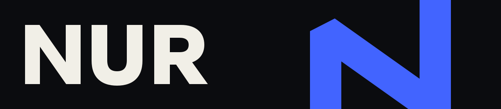
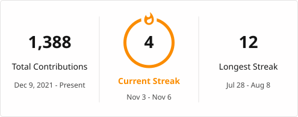

  

# NurHabib Assolihudin

**Systems & Product Engineer**

Modular applications · Backend services · Developer infrastructure

  
  
  

I'm **NurHabib**. I build web applications, backend services, and tools for developers.

I like tracing how a product works: where its data lives, how services communicate, and what happens when a connection fails. That takes me from product features to the systems underneath them.

## What I build

- **Modular applications** — business software, project workspaces, and shared interface components.
- **Backend services & systems integration** — APIs, service communication, message queues, and background processing.
- **Developer infrastructure** — libraries for browser storage, workers, and offline data synchronization.

## Current focus

I'm developing modular business applications through **Ocaty** and exploring offline-first infrastructure through **Oxelot**, with attention to module boundaries, data flow, and developer experience.

**Work experience:** R&D Developer at **PT Semesta Teknologi Informatika**.

## Selected projects

The projects below are personal work, separate from my employment. For ORCA, Ocaty, and Oxelot, I handle planning, branding, development, deployment, and marketing.

### [ORCA](https://orca.ocaty.com)

A project workspace for documents, tasks, and schedules, with document, board, and calendar views.

### [Ocaty](https://nurhabibassolihudin.github.io/en/#project-ocaty)

A modular business application platform covering commerce, CRM, and ERP. My work includes frontend modules, shared UI components, and account and notification services.

Working on Ocaty has taught me to understand the goal behind an idea before judging it against the alternatives I already know.

**Technology:** React, Module Federation, FastAPI, PostgreSQL, Docker.

### [Oxelot](https://github.com/NurHabibAssolihudin/Oxelot)

Offline-first developer infrastructure for browser storage, worker management, and data synchronization.

**Technology:** TypeScript, OPFS, WASM SQLite, Web Workers.

### [RabbitMQ Chat](https://github.com/NurHabibAssolihudin/RabbitMQ-Chat-App)

A realtime communication experiment. FastAPI applications publish messages to RabbitMQ; a receiver consumes them and broadcasts updates to connected browsers through WebSockets.

**Technology:** Python, FastAPI, RabbitMQ, WebSockets.

## Technical interests

- Module boundaries, shared contracts, and the cost of coupling services.
- Backend design, data flows, and event-driven communication.
- Offline-first storage, background workers, and synchronization.
- Developer tools that make a system easier to understand and work with.

**Applications & APIs**

  
  
  
  

**Data & infrastructure**

  
  
  
  

GitHub activity

  <picture>
    <source media="(prefers-color-scheme: dark)" srcset="./profile/streak-dark.svg" />
    <source media="(prefers-color-scheme: light)" srcset="./profile/streak-light.svg" />
    
  </picture>
  <picture>
    <source media="(prefers-color-scheme: dark)" srcset="./profile/top-langs-dark.svg" />
    <source media="(prefers-color-scheme: light)" srcset="./profile/top-langs-light.svg" />
    
  </picture>

## Currently exploring

- How independently developed modules can share UI and contracts without becoming tightly coupled.
- What an application should do while offline, and how it reconciles changes after reconnecting.
- Where message queues and workers help, and where simpler request–response code is enough.

Side experiments

- **[Tony](https://github.com/NurHabibAssolihudin/Tony)** — experiments with a self-hosted assistant and persistent memory.
- **[GenUI](https://github.com/NurHabibAssolihudin/GenUI)** — a prototype for natural-language interface controls.

## Connect with me

For product engineering roles, backend and integration work, or a technical conversation.

  
  
  

[nurhabibassolihudin12@gmail.com](mailto:nurhabibassolihudin12@gmail.com)

