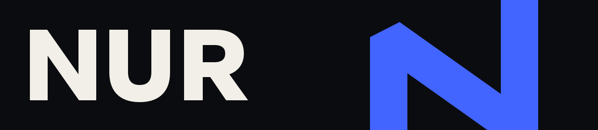
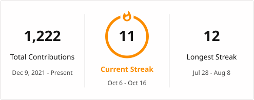

  

# NurHabib Assolihudin

**Web applications · Systems integration · Developer tools**

  
  
  

## About me

I'm **Nur**, a developer working across web applications, backend services and tools for other developers.

I like understanding how the pieces work together: the interface someone uses, the services behind it, and the data moving between them. I care about making that machinery understandable and the experience worth using.

## What I build

- **Web applications** — project workspaces, business applications and shared interface components.
- **Systems integration & automation** — APIs, service integrations, messaging and background processing.
- **Developer tools** — browser storage, workers and offline data synchronization.
- **AI experiments** — self-hosted assistants and prototypes for working with interfaces through natural language.

## Projects & experiments

### Applications & developer tools

- **[ORCA](https://orca.ocaty.com)** — a self-hostable workspace for project documents, tasks and schedules, with document, board and calendar views.
- **[Ocaty](https://nurhabibassolihudin.github.io/en/#project-ocaty)** — modular business applications, connecting frontend modules, shared components, and account and notification services.
- **[Oxelot](https://github.com/NurHabibAssolihudin/Oxelot)** — browser storage, worker management and offline synchronization, using TypeScript, OPFS and WASM SQLite.

These three are personal projects. I handle their planning, branding, development, deployment and marketing.

### Experiments in AI & communication

- **[Tony](https://github.com/NurHabibAssolihudin/Tony)** — a self-hosted assistant setup built around Letta Code, with persistent memory and a CLI-first interface.
- **[GenUI](https://github.com/NurHabibAssolihudin/GenUI)** — a dashboard prototype for natural-language layout controls, built with FastAPI, Jinja2 and a mock AI layer.
- **[RabbitMQ Chat](https://github.com/NurHabibAssolihudin/RabbitMQ-Chat-App)** — realtime communication with FastAPI, WebSockets and RabbitMQ; an experiment in queues and message delivery.

## Tech stack

**Applications & APIs**

  
  
  
  

**Data & infrastructure**

  
  
  
  

## Work experience

**R&D Developer** at **PT Semesta Teknologi Informatika**.

[Professional background on LinkedIn](https://www.linkedin.com/in/nurhabib-assolihudin)

## GitHub activity

  <picture>
    <source media="(prefers-color-scheme: dark)" srcset="./profile/streak-dark.svg" />
    <source media="(prefers-color-scheme: light)" srcset="./profile/streak-light.svg" />
    
  </picture>
  <picture>
    <source media="(prefers-color-scheme: dark)" srcset="./profile/top-langs-dark.svg" />
    <source media="(prefers-color-scheme: light)" srcset="./profile/top-langs-light.svg" />
    
  </picture>

## Let's connect

For projects, engineering roles, or a technical conversation.

  
  
  

[nurhabibassolihudin12@gmail.com](mailto:nurhabibassolihudin12@gmail.com)

