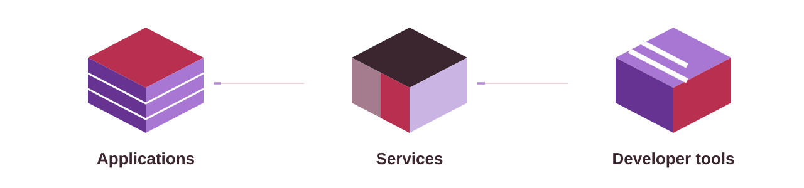
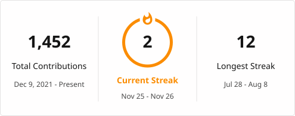
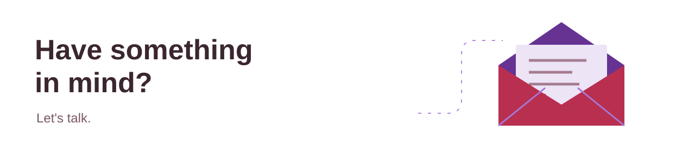

  

# NurHabib Assolihudin

**Systems & Product Engineer**

I build web applications, backend services, and tools for developers. I like following a feature beyond its interface: where the data goes, how services communicate, and what happens when the connection drops.

  
  
  

[Work](#selected-work) · [Tools](#tools-i-work-with) · [Notes](#things-im-working-through) · [Contact](#lets-talk)

## From the interface to the system underneath

- **Applications:** business software, project workspaces, and reusable components.
- **Services:** APIs, queues, background processing, and communication between systems.
- **Developer tools:** browser storage, workers, and offline data synchronization.

**Work experience** · R&D Developer at **PT Semesta Teknologi Informatika**.

## Selected work

These are personal projects, separate from my employment. For ORCA, Ocaty, and Oxelot, I work across planning, branding, code, deployment, and marketing.

### ORCA

A workspace for documents, tasks, and schedules

Document, board, and calendar views in one project workspace. My work includes the application itself and the interactions that connect those views.

[Visit ORCA](https://orca.ocaty.com) · [Read the case study](https://nurhabibassolihudin.github.io/en/projects/orca/)

### Ocaty

Modular business applications

A platform for business software, with experiments around frontend modules, shared components, and backend services. The development has moved from modular frontend experiments toward a more focused initial release.

**Working with:** React, Module Federation, FastAPI, PostgreSQL, Docker.

One lesson I keep coming back to: a client's idea can solve a different problem from the one I first see. I need to understand their perspective before deciding what I think would work better.

[Read the case study](https://nurhabibassolihudin.github.io/en/projects/ocaty/)

### Oxelot

Browser storage, workers, and offline data

Developer infrastructure for applications that need to keep working offline. I explore how browser storage, worker management, and synchronization can fit together without hiding how they behave.

**Working with:** TypeScript, OPFS, WASM SQLite, Web Workers.

[Explore the repository](https://github.com/NurHabibAssolihudin/Oxelot) · [Read the case study](https://nurhabibassolihudin.github.io/en/projects/oxelot/)

### RabbitMQ Chat

Following a message across services

A realtime communication experiment: FastAPI applications publish messages to RabbitMQ, then a receiver consumes them and broadcasts updates to browsers through WebSockets.

**Working with:** Python, FastAPI, RabbitMQ, WebSockets.

[Explore the repository](https://github.com/NurHabibAssolihudin/RabbitMQ-Chat-App)

## Tools I work with

| Area | Tools |
| :-- | :-- |
| Languages |  |
| Applications & APIs |  |
| Data & messaging |  |
| Deployment |  |

## Things I'm working through

The interesting part for me is often where two parts of a system meet.

- How can independently developed modules share a UI and contracts without becoming tightly coupled?
- What should an application do offline, and how should it reconcile changes afterward?
- When do queues and workers help, and when is a simple request–response flow enough?

### Other experiments

AI and interface prototypes

- **[Tony](https://github.com/NurHabibAssolihudin/Tony)** — a self-hosted assistant and persistent-memory experiment.
- **[GenUI](https://github.com/NurHabibAssolihudin/GenUI)** — a prototype for natural-language interface controls.

### GitHub activity

Contribution streak and repository languages

  <picture>
    <source media="(prefers-color-scheme: dark)" srcset="./profile/streak-dark.svg" />
    <source media="(prefers-color-scheme: light)" srcset="./profile/streak-light.svg" />
    
  </picture>
  <picture>
    <source media="(prefers-color-scheme: dark)" srcset="./profile/top-langs-dark.svg" />
    <source media="(prefers-color-scheme: light)" srcset="./profile/top-langs-light.svg" />
    
  </picture>

## Let's talk

For product engineering roles, backend and integration work, or a conversation about something you're building.

  
  
  

[nurhabibassolihudin12@gmail.com](mailto:nurhabibassolihudin12@gmail.com)
